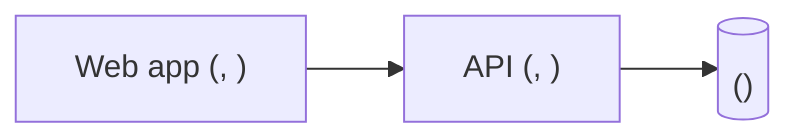

# Blueprint: <product name>

Concept: `docs/CONCEPT.md` · Stack: `docs/stack.md` · Design: `docs/design/index.md`

## Architecture

<!-- One node per running part of docs/stack.md (the web app, the API, the database; a runtime service row only when a module calls it), each labelled with the Chosen: value of its row; the placeholders name the category. A part on the exclusion ledger has no node. Never a technology that is not a Chosen: line. The gate page draws this block. -->

## Domain model

<!-- One row per entity, in the concept's words. -->

| Entity | Key fields | Relations |
|---|---|---|
| <entity> | <fields> | <relations> |

## Modules

<!-- One project per running part of the stack (inside the monorepo when docs/stack.md has that row), and the modules inside each. -->

| Module | Project | Owns | Depends on |
|---|---|---|---|
| <module> | <api or web> | <what it owns> | <modules> |

## API surface

| Method | Path | Purpose | Module |
|---|---|---|---|
| <GET> | </path> | <one line> | <module> |

## Screens

<!-- One row per row of ## Inventory in docs/design/index.md, in its order: the same Screen and the same Id, none added and none dropped; this document adds only what each screen calls. In the no-UI form, this section is the design's one line, No screens: ui-library excluded by Ruling N, and no table. -->

| Screen | Id | Purpose | Calls |
|---|---|---|---|
| <screen> | `<screen-id>` | <one line> | <endpoints> |

## Decisions

<!-- One row per ADR written at this stage, numbered after the highest NNNN already in docs/adr/; the stack stage's ADRs are approved at the stack gate and are not repeated here. This line is what gate 2 approves: the digest covers this document, not docs/adr/. -->

| ADR | Decision |
|---|---|
| [NNNN](adr/NNNN-<slug>.md) | <the decision in one line> |

## Epics

<!-- Row 1 is the walking skeleton. List every epic. Keys match [A-Z][A-Z0-9]* (docs/CONTRACT.md); the specs stage uses them. -->

| # | Key | Epic | Delivers |
|---|---|---|---|
| 1 | <KEY> | Walking skeleton: <title> | <one real user action, deployed end to end through every running part of the stack> |
| 2 | <KEY> | <title> | <one line> |

## Open threads

<!-- What is deliberately undecided, each with what would settle it and at which stage. -->

- <thread>: settled by <what would decide it>
