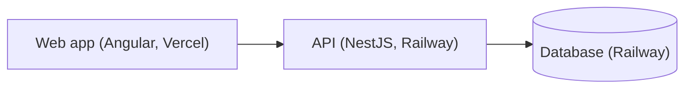

# Blueprint: <product name>

Concept: `docs/CONCEPT.md`

## Stack

<!-- Fixed by the plugin and not reopened here. Name the ADR behind anything the stack leaves open. -->

| Part | Technology | Runs on |
|---|---|---|
| Monorepo | Nx | — |
| Web app | Angular | Vercel |
| API | NestJS | Railway |
| Data access | Prisma | — |
| Database | <engine> ([0001](adr/0001-<slug>.md)) | Railway |

## Architecture

<!-- The deployed parts and what calls what. The gate page draws this block. -->

## Domain model

<!-- One row per entity, in the concept's words. -->

| Entity | Key fields | Relations |
|---|---|---|
| <entity> | <fields> | <relations> |

## Modules

<!-- The Nx projects and the NestJS and Angular modules inside them. -->

| Module | Project | Owns | Depends on |
|---|---|---|---|
| <module> | <api or web> | <what it owns> | <modules> |

## API surface

| Method | Path | Purpose | Module |
|---|---|---|---|
| <GET> | </path> | <one line> | <module> |

## Screens

| Screen | Purpose | Calls |
|---|---|---|
| <screen> | <one line> | <endpoints> |

## Decisions

<!-- One row per ADR. This line is what gate 2 approves: the digest covers this document, not docs/adr/. -->

| ADR | Decision |
|---|---|
| [0001](adr/0001-<slug>.md) | <the decision in one line> |

## Epics

<!-- Row 1 is the walking skeleton. List every epic. Keys match [A-Z][A-Z0-9]* (docs/CONTRACT.md); the specs stage uses them. -->

| # | Key | Epic | Delivers |
|---|---|---|---|
| 1 | <KEY> | Walking skeleton: <title> | <one real user action, deployed end to end through every part> |
| 2 | <KEY> | <title> | <one line> |

## Open threads

<!-- What is deliberately undecided, each with what would settle it and at which stage. -->

- <thread>: settled by <what would decide it>
